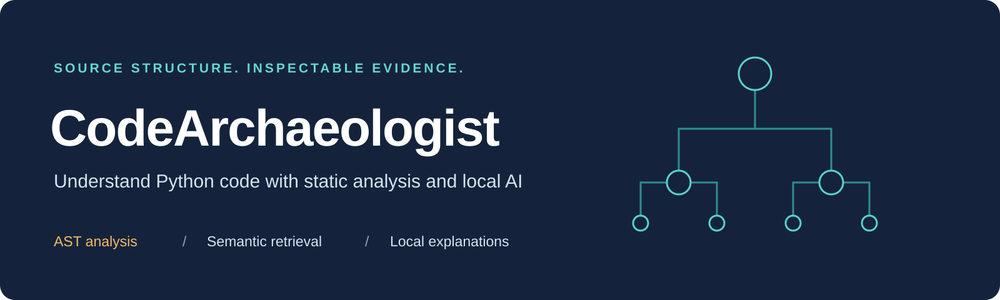
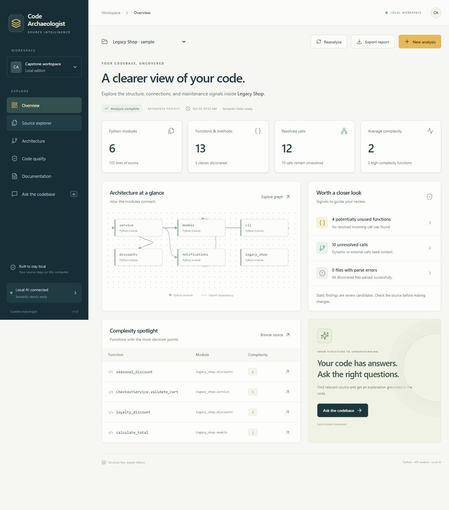
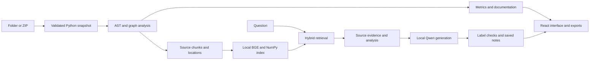

<p align="center">
  
</p>

<p align="center">
  <strong>Python code intelligence, powered by static analysis and local AI.</strong><br />
  Explore an unfamiliar project, follow its structure, and review explanations beside the source.
</p>

<p align="center">
  <a href="docs/GETTING_STARTED.md">Get started</a> ·
  <a href="docs/ARCHITECTURE.md">Architecture</a> ·
  <a href="docs/academic/README.md">Capstone materials</a> ·
  <a href="docs/DEMO_GUIDE.md">Live demo</a> ·
  <a href="verification/VERIFICATION.md">Verification</a>
</p>

---

## Overview

**CodeArchaeologist** is a working local application for Python code comprehension and automated documentation. Import a project folder or ZIP, browse its definitions, inspect dependency and call graphs, review quality findings, search by meaning, and ask a local model questions with file and line references.

Source analysis, embedding inference, and generation run on your computer after first-time setup. A GPU and a paid API key are not required. The application parses imported source without running it.

**Stack:** Python AST · FastAPI · React · SQLite · BGE embeddings · NumPy · Qwen · llama.cpp



## What you can do

| Workflow | What the application provides |
| --- | --- |
| Understand structure | Functions, classes, imports, signatures, and source locations |
| Trace relationships | Interactive module-dependency and supported function-call graphs |
| Review maintainability | Complexity, long functions, parse errors, unresolved calls, and potentially unused symbols |
| Find relevant code | Local semantic retrieval with lexical matching and inspectable source excerpts |
| Ask and explain | Local-model answers, symbol explanations, and saved documentation with source links |
| Keep and share results | Persistent project snapshots and JSON, Markdown, SVG, and offline HTML exports |

<details>
<summary><strong>See the local AI interface</strong></summary>


Generated answers and citations require review. A recognized source label does not prove that a sentence is correct.

</details>

## Quick start

### Windows x64

Install **Python 3.12**, the tested Python version, and add it to PATH. Clone or download this repository into a writable folder:

```powershell
git clone https://github.com/vishaljangir1929/CodeArchaeologist.git
cd CodeArchaeologist
```

Run these launchers in order:

```powershell
.\INSTALL.bat
.\SETUP_AI.bat
.\START.bat
```

`INSTALL.bat` installs the Python application. `SETUP_AI.bat` downloads the checksum-verified CPU runtime, code model, and embedding model. `START.bat` opens **http://127.0.0.1:8765**. Keep its terminal open and press **Ctrl+C** when finished.

First-time setup needs internet access and at least **2 GB free disk space**. The code-model file is approximately **718 MiB**. Downloaded models and installed dependencies are not committed to Git.

The original prepared delivery on the author's computer already has its dependencies and models. That copy can launch directly with `START.bat`. A fresh GitHub clone needs the setup steps above.

Choose **Legacy Shop** for a first walkthrough, or select **New analysis** to import your own Python project. Follow the [setup and troubleshooting guide](docs/GETTING_STARTED.md) for details.

## How it works



Python AST and custom graph logic extract the program structure. BGE-small-en-v1.5 embeds source chunks locally. Retrieval combines semantic and lexical similarity. Qwen2.5-Coder-1.5B-Instruct Q2_K receives bounded source evidence and structured analysis through llama.cpp. SQLite stores projects and successful AI notes.

The project integrates pretrained models. It does not train or fine-tune them. See the [technical architecture](docs/ARCHITECTURE.md) and [upstream acknowledgements](THIRD_PARTY.md).

## One repository for the whole project

```text
CodeArchaeologist/
├── src/codearchaeologist/     Python engine, API, packaged UI, and reference source
├── frontend/                 Editable React source and lockfile
├── tests/                    Analyzer, CLI, API, input, and generation-protocol checks
├── scripts/                  Installation, model setup, and real-model verification
├── tools/                    Repository integrity checks
├── sample_project/           Legacy Shop reference project
├── verification/             Recorded checks, real responses, screenshots, sample export
├── docs/
│   ├── GETTING_STARTED.md    Setup and troubleshooting
│   ├── USER_GUIDE.md         Detailed application and command-line usage
│   ├── ARCHITECTURE.md       Implementation, storage, and API contracts
│   ├── DEMO_GUIDE.md         Demonstration and viva preparation
│   ├── ROADMAP.md            Current scope and next evaluation work
│   ├── assets/              Repository artwork
│   └── academic/
│       ├── phase-1/         Current report, PowerPoint, PDF, notes, and diagrams
│       └── archive/         Earlier presentation PDFs for reference
└── .github/                  CI workflow and contribution templates
```

## Capstone review materials

| Deliverable | Open |
| --- | --- |
| Phase-I technical report, 34 pages | [PDF](docs/academic/phase-1/CodeArchaeologist_Phase1_Report.pdf) · [editable text](docs/academic/phase-1/CodeArchaeologist_Phase1_Report_Editable.md) |
| Phase-I presentation, 28 slides | [editable PowerPoint](docs/academic/phase-1/CodeArchaeologist_Phase1_Presentation.pptx) · [PDF](docs/academic/phase-1/CodeArchaeologist_Phase1_Presentation.pdf) |
| Presentation preparation | [speaker notes](docs/academic/phase-1/Presenter_Notes.md) · [demo guide](docs/DEMO_GUIDE.md) |
| Review requirements | [submission checklist](docs/academic/phase-1/Submission_Checklist.pdf) · [academic index](docs/academic/README.md) |

These are review materials, not a record of faculty approval. The actual college sample format, current team/guide details, genuine geotagged work photographs, signatures, and approval still need confirmation before final submission.

## Verification and practical limits

The [recorded verification](verification/VERIFICATION.md) on 23 October 2026 includes **15 passing tests**, browser workflows, and actual local-model calls. On four handwritten questions about the six-file reference project, exact-symbol retrieval succeeded in the top three for **2/4** questions. Source excerpts covering the expected function appeared in the top three for **4/4**.

These are small functional checks, not general accuracy estimates. One recorded CPU question took **24.73 seconds**. The [raw results](verification/live-model-results.json) retain answers, source references, and timing.

- Static call resolution is heuristic. Dynamic dispatch, callbacks, reflection, and framework behavior can remain unresolved.
- Potentially unused symbols need human review before deletion.
- AI facts and citations can be wrong, including when the supplied source label is valid.
- Reanalyze rebuilds a saved snapshot. Import changed source as a new project.
- This edition supports local single-user Python analysis. Accounts, public hosting, Git URL cloning, other languages, duplicate-code detection, and live folder watching are future work.

## Development

After installation, run the regression suite:

```powershell
.\.venv\Scripts\python.exe -m unittest discover -s tests -v
python tools/check_repository.py
```

To rebuild the frontend with Node.js 24:

```powershell
cd frontend
npm ci
npm run build
```

The compiled interface lives in `src/codearchaeologist/web/`. The CI workflow checks repository links, runs the offline regression suite, builds a Python wheel, and rebuilds the frontend. Real-model evaluation remains a separate local procedure.

Read [Contributing](CONTRIBUTING.md) before changing the project, and see [the roadmap](docs/ROADMAP.md) for the next evaluation priorities.

## Team and acknowledgement

This capstone is associated with the School of Engineering and Technology, CMR University. The supplied presentation identifies **Vishal Kumar Jangir**, **Syed Mudassir**, and **Junaid Pasha**, with **Mr. Sheik Jamil Ahmed** as guide. Confirm these details against the current institutional record.

Research, model, and software dependencies are acknowledged in [THIRD_PARTY.md](THIRD_PARTY.md). A license for the project's original code has not yet been selected by the maintainers.
