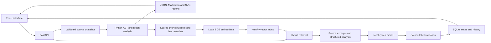

# Implementation architecture

## Source layout

```text
run.py                         Source launcher
INSTALL.bat / START.bat         Windows setup and launch
SETUP_AI.bat                   First-time model installation
scripts/bootstrap.py           Virtual environment and editable application installation
scripts/setup_ai.py            Checksum-verified local runtime/model download and embedding setup
scripts/verify_live.py          Real-model verification against the reference project
frontend/src/main.jsx           React application
frontend/src/style.css          Responsive interface styles
frontend/build.mjs              Local asset bundling
src/codearchaeologist/
  collector.py                 Python source discovery and module naming
  parser.py                    AST extraction, nested definitions, calls, complexity
  analyzer.py                  Import/call resolution, graph construction, quality findings
  models.py                    Typed static-analysis records
  reporter.py                  JSON, Markdown, SVG, and offline HTML export
  ingestion.py                 Folder snapshots, bounded ZIP extraction, source access
  config.py                    Local paths, model settings, application errors
  storage.py                   SQLite project and AI-note persistence
  retrieval.py                 AST-based chunks, local embeddings, hybrid retrieval
  ai.py                        Local generation, constrained facts, source-label validation
  service.py                   Application workflows and grounded context assembly
  api.py                       HTTP routes and browser request restrictions
  server.py                    Local model lifecycle and Uvicorn launcher
  web/                         Prebuilt React assets and offline report template
  demo/                        Packaged reference Python source
tests/                         Analyzer, CLI, ingestion, API, persistence, and AI-protocol tests
data/                          Generated local workspace, excluded from source package
.models/                       Downloaded local model files, excluded from source package
.runtime/                      Local CPU runtime/dependencies, excluded from source package
```

## Data flow



1. The UI submits a folder path or ZIP to the local backend.
2. Ingestion validates input and copies supported source into a new project snapshot. The original project is unchanged.
3. AST parsing extracts typed symbol/import/call records and source locations. Parse failures become explicit findings.
4. Analysis resolves supported relationships, computes metrics, and records review candidates and unresolved calls.
5. Report generation writes machine-readable JSON, module references, diagrams, and an offline dashboard.
6. Retrieval splits AST-selected source into bounded chunks. BGE embeddings are normalized and stored as a NumPy matrix with JSON source metadata. If the installed semantic model is unavailable, the index is explicitly labeled lexical.
7. A search query is encoded with the same embedding model and ranked using semantic similarity plus lexical matches.
8. Generation receives only bounded source evidence and relevant structured analysis. It returns schema-constrained short facts tied to supplied source labels.
9. The backend validates the source labels, saves successful notes, and returns evidence links to the UI. It does not claim that valid labels prove factual correctness.
10. Export packages reports and saved AI notes into a downloadable ZIP.

## Storage

`data/workspace.sqlite3` contains `projects` and `notes` tables. Each project has a generated UUID, name, input type, timestamps, lifecycle status, stage, optional error, metrics, and retrieval mode.

`data/projects/<id>/source/` holds the immutable Python snapshot. `report/` holds exports. `index/` holds `chunks.json`, `manifest.json`, and optional `vectors.npy`.

Source locations returned by the API are relative to the snapshot. The source endpoint only serves Python files listed in that project's analysis. Generated project identifiers and ZIP paths are checked before being used in filesystem access.

Analyses have queued, running, ready, or failed states. An interrupted task is marked failed at the next application startup. The local edition runs CPU analysis/indexing serially; it is not a distributed job service.

## Analysis JSON

The top-level `schema_version` is `1.0.0`. Sections are:

- `project`: name, snapshot root, generation time.
- `summary`: module, class, function, line, edge, unresolved-call, error, and candidate counts.
- `modules`, `classes`, `functions`: structured symbols and source locations.
- `call_graph`: nodes and supported resolved edges.
- `module_dependencies`: directed import relationships.
- `unresolved_calls`: calls the resolver could not confidently link.
- `dead_code`: potentially unused function/class candidates.
- `quality`: high-complexity, long-function, and syntax-error findings.
- `limitations`: interpretation boundaries.
- `ai_context`: evidence sections available to generation.

Web snapshots use `project.root = "."` and relative source file paths. Direct CLI analysis retains the analyzed local paths in its report.

## API routes

| Method | Route | Purpose |
| --- | --- | --- |
| GET | `/api/health` | Application health/version |
| GET | `/api/ai/status` | Generation and semantic-model readiness |
| GET | `/api/projects` | Saved projects |
| POST | `/api/projects/demo` | Import the reference project |
| POST | `/api/projects/folder` | Import a local folder using JSON `{path, name}` |
| POST | `/api/projects/upload` | Import a multipart ZIP field named `file` |
| GET | `/api/projects/{id}` | Project state |
| GET | `/api/projects/{id}/analysis` | Structured report |
| POST | `/api/projects/{id}/reanalyze` | Reanalyze stored snapshot and rebuild index |
| GET | `/api/projects/{id}/source?file=...` | A validated snapshot file |
| GET | `/api/projects/{id}/search?q=...` | Semantic/hybrid or explicitly lexical retrieval |
| POST | `/api/projects/{id}/ask` | Generate a source-linked answer from `{question}` |
| POST | `/api/projects/{id}/explain` | Explain `{symbol_id}` or generate an overview |
| GET | `/api/projects/{id}/history` | Saved question history |
| GET | `/api/projects/{id}/documentation` | Static summary and saved explanations |
| GET | `/api/projects/{id}/export` | Download ZIP |
| GET | `/openapi.json` | Machine-readable API schema |

Generation failures are returned as errors rather than silently replaced with mock answers. Successful notes record the actual provider, model, answer, evidence, and time.

## Deliberate boundaries

This release supports local single-user operation and Python source. It does not implement user authentication, cloud deployment, GitHub account integration, repository cloning, live source watching, model training, duplicate-code detection, or a proof of program reachability. Those capabilities should not be claimed in the final presentation as implemented features.
