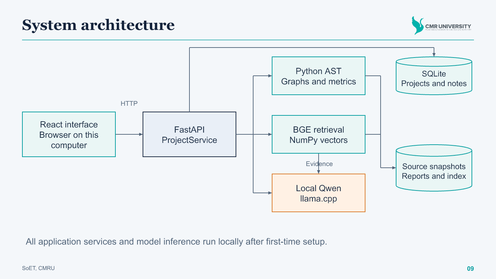
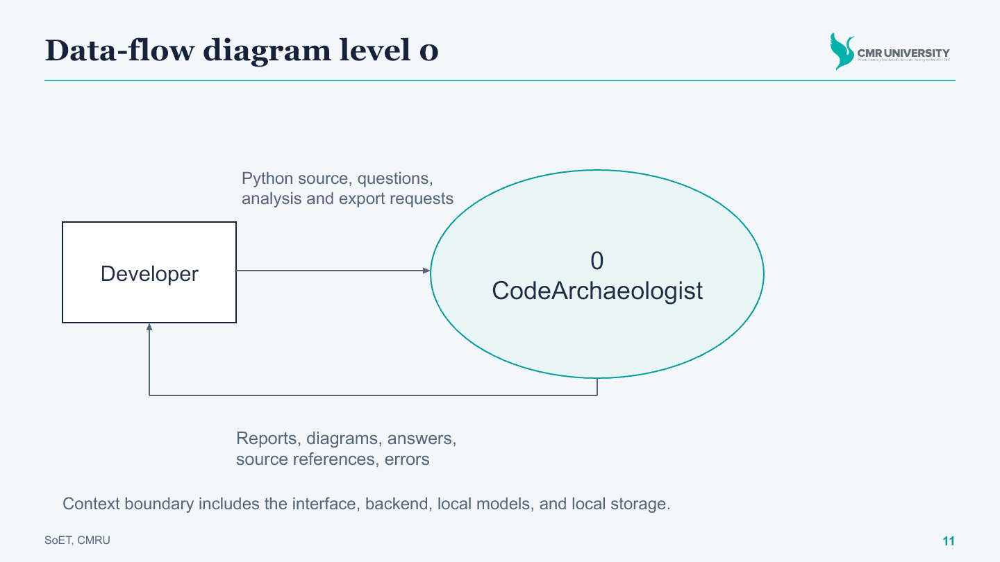
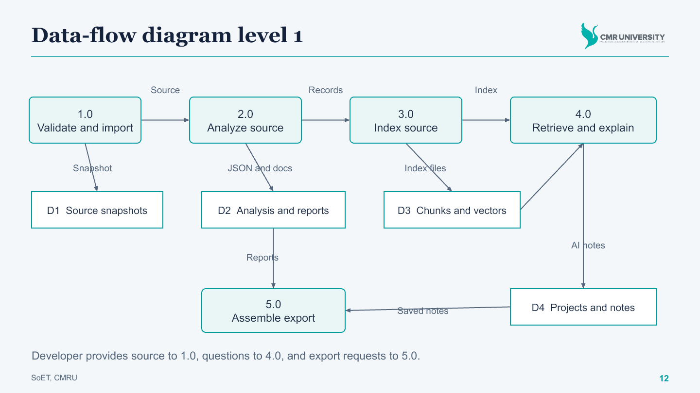
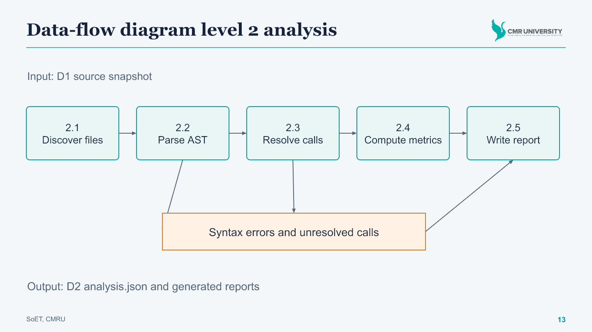
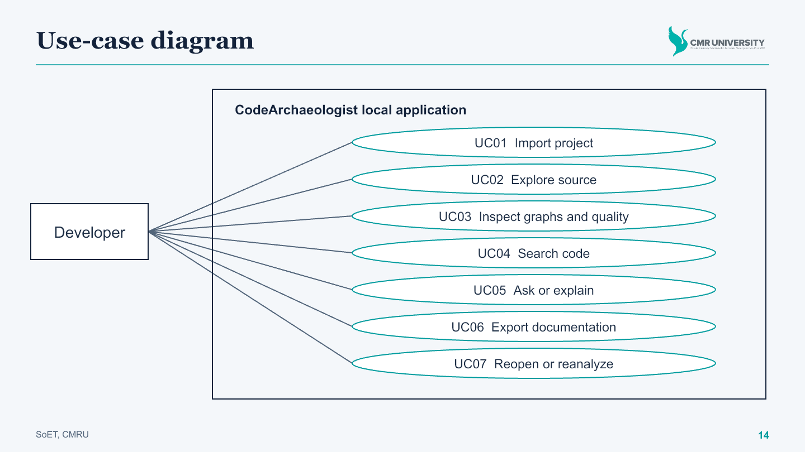
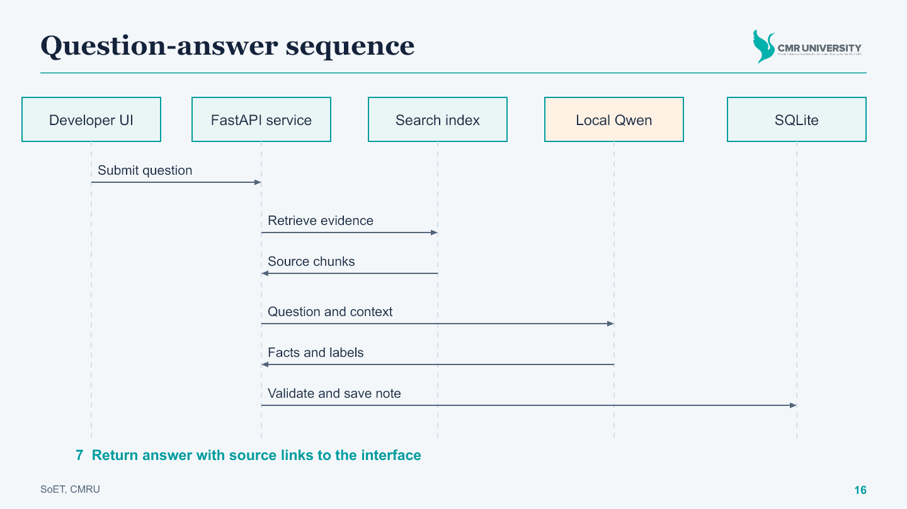
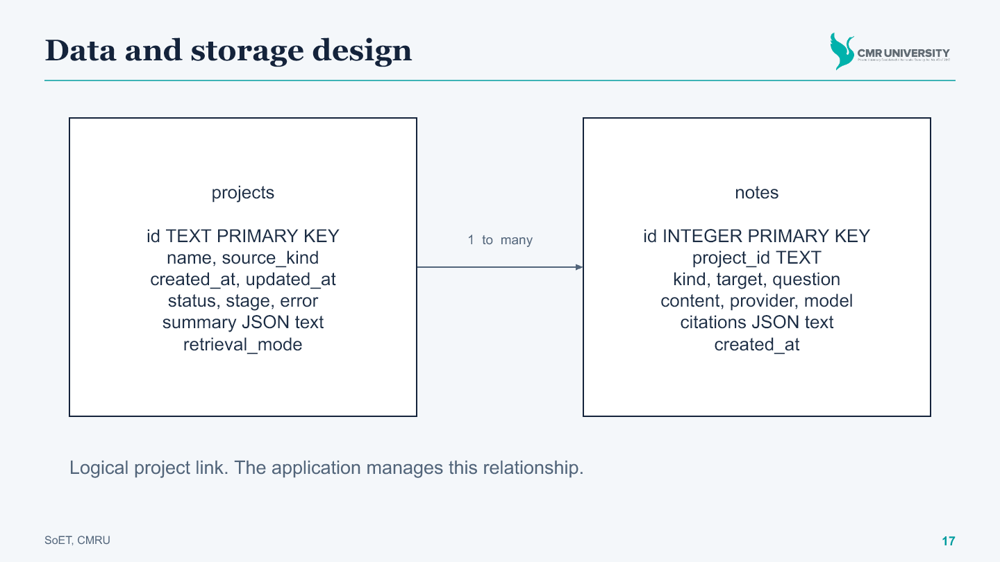
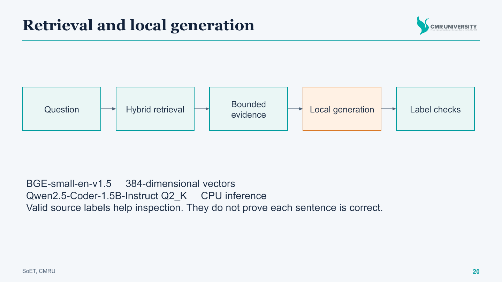
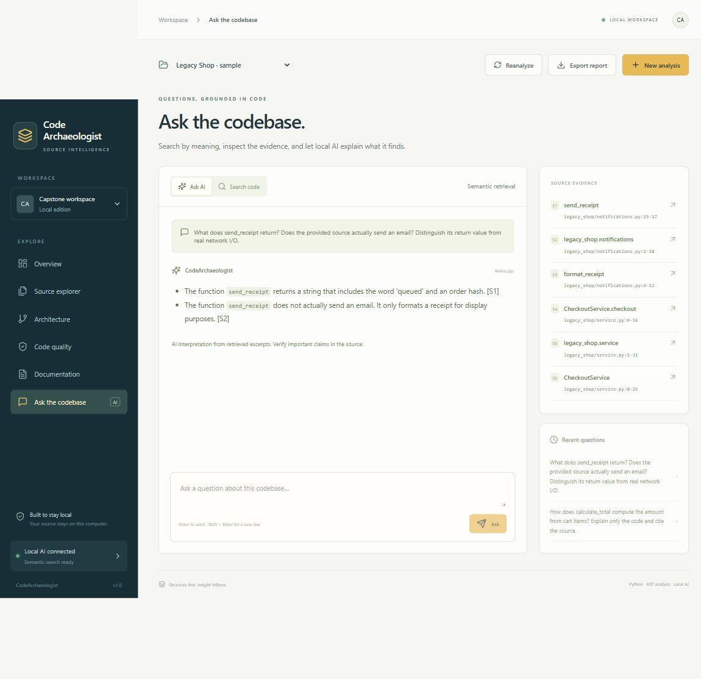

SCHOOL OF ENGINEERING AND TECHNOLOGYDEPARTMENT OF COMPUTER SCIENCE AND ENGINEERING

Phase I Project Report

CodeArchaeologist

An AST-Guided, LLM-Powered System for Legacy Code Comprehension and Automated Documentation

Submitted in partial fulfilment of the requirements for theBachelor of Technology in Computer Science and Engineering

| Submitted by | USN |
| --- | --- |
| Vishal Kumar Jangir | 23BBTCS280 |
| Syed Mudassir | 23BBTCS258 |
| Junaid Pasha | 23BBTCS257 |

Under the guidance ofMr. Sheik Jamil AhmedDepartment of CSE

CMR UniversityAcademic Year 2026 to 2027October 2026


# Departmental endorsement


Project CodeArchaeologist

An AST-Guided, LLM-Powered System for Legacy Code Comprehension and Automated Documentation

Programme Bachelor of Technology in Computer Science and Engineering

Institution School of Engineering and Technology, CMR University

| Student | USN |
| --- | --- |
| Vishal Kumar Jangir | 23BBTCS280 |
| Syed Mudassir | 23BBTCS258 |
| Junaid Pasha | 23BBTCS257 |

The departmental certificate and endorsement are to be completed by the authorised faculty after review of the Phase I report and presentation. The spaces below record approval when it is granted.

Guide signature __________________________Name Mr. Sheik Jamil AhmedDate __________________________

Head of Department signature __________________________Name and designation __________________________Date __________________________

Reviewer signature __________________________Review date __________________________


# Declaration and acknowledgement


## Student declaration


We submit this report describing CodeArchaeologist, its design, local implementation, and recorded verification. Before signing, we will verify that the report reflects our understanding and work, that reused software and research are acknowledged, and that all institutional requirements on authorship and permitted assistance have been met.

| Student | Signature | Date |
| --- | --- | --- |
| Vishal Kumar Jangir | ________________ | ____________ |
| Syed Mudassir | ________________ | ____________ |
| Junaid Pasha | ________________ | ____________ |


## Acknowledgement


We acknowledge the academic guidance of Mr. Sheik Jamil Ahmed and the learning environment provided by the Department of Computer Science and Engineering, School of Engineering and Technology, CMR University.

The project uses published research and open-source software for language processing, local inference, embeddings, application serving, and interface development. These contributions are identified in the references and in the software delivery. The project contribution lies in integrating source ingestion, static analysis, source navigation, retrieval, explanations, and report generation into a working local application.

The evaluation statements in this report refer only to the recorded checks. They do not claim general accuracy, production readiness, or measured reductions in developer onboarding time.


# Abstract


CodeArchaeologist is a local application for understanding unfamiliar Python code and generating documentation. It combines static analysis with language-model assistance so that a developer can inspect source structure before reviewing an explanation. The system accepts a local folder, a ZIP archive, or a supplied reference project. It creates a Python-only source snapshot, extracts definitions and imports through the Python abstract syntax tree, resolves supported call relationships, and records metrics and review candidates. A React interface presents source locations, module dependencies, function calls, quality findings, and documentation. AST-derived source chunks support semantic retrieval using local BGE embeddings and a NumPy vector index. A local Qwen code model receives bounded evidence and structured analysis to produce short explanations with source references. SQLite stores project metadata and successful AI notes. Reports export as JSON, Markdown, SVG diagrams, and an offline HTML view. The implemented edition supports a single user on the same computer and does not execute imported source. Fifteen automated tests passed, and actual local-model checks were recorded on a six-file reference project. These checks establish functional operation rather than broad accuracy. Dynamic call resolution, unused-code classification, generated explanations, and citation relevance remain subject to developer review. The Phase I report documents the requirements, architecture, detailed design, data flows, use cases, implementation, and observed verification results.

Keywords Abstract syntax tree, code comprehension, static analysis, local language model, semantic retrieval, automated documentation.


# Contents


Page numbers below refer to the numbered body of this report. Front matter uses Roman numerals.


# Abbreviations and figure guide


| Abbreviation | Meaning |
| --- | --- |
| AST | Abstract syntax tree |
| API | Application programming interface |
| DFD | Data-flow diagram |
| LLM | Large language model |
| LOC | Lines of code |
| RAG | Retrieval-augmented generation |
| UML | Unified Modeling Language |
| GGUF | Model file format used by the local inference runtime |


## Principal design figures


Figure 4.1 System architecture

Figure 4.2 DFD level 0 context

Figure 4.3 DFD level 1 processes and stores

Figure 4.4 DFD level 2 static analysis

Figure 4.5 Use-case diagram

Figure 4.6 Question-answer sequence

Figure 4.7 Logical data model

Figure 5.1 Retrieval and generation flow


# 1 Introduction


## 1.1 Background


Maintaining an existing software project often begins with locating the definitions and relationships that explain its behavior. In an undocumented Python repository, a developer may need to inspect imports, follow calls across modules, identify an entry point, and determine which functions deserve closer review. Comments alone may not describe current behavior, and a name such as send_receipt does not prove that a function performs network delivery.

Static analysis makes some of this structure explicit without running the program. Python AST records identify definitions, imports, calls, and source locations. Graphs then provide a navigable view of supported relationships. A language model can help explain code in ordinary language, but it may overlook control flow, infer unsupported intent, or cite an irrelevant excerpt. CodeArchaeologist therefore retains inspectable source evidence alongside generated text.


## 1.2 Problem statement


The project addresses the difficulty of exploring an unfamiliar Python codebase and producing an initial technical description of its structure and behavior. The required tool must combine source navigation, static reports, retrieval, and explanations in one local workflow. It must preserve unresolved relationships and generation failures so that uncertainty remains visible.


## 1.3 Intended users and value


The intended user is a developer, student, or reviewer examining a Python project on their own computer. The application can support an initial source walkthrough, documentation preparation, and selection of code for manual review. The present evaluation does not measure how much developer time it saves. Its demonstrated value is the working connection between source, structured findings, diagrams, and explanations.


# Objectives and project scope


## 1.4 Final objectives


| ID | Objective | Observable output |
| --- | --- | --- |
| O1 | Extract Python program structure | Definitions, imports, calls, source locations |
| O2 | Visualize supported relationships | Module-dependency and function-call graphs |
| O3 | Identify review candidates | Complexity, long functions, syntax errors, unused candidates |
| O4 | Generate documentation and explanations | Static documents and saved source-linked AI notes |
| O5 | Support natural-language discovery | Ranked source excerpts and local-model answers |


## 1.5 Implemented scope


The edition accepts local folders, uploaded ZIP archives, and an included reference project. It supports Python source, a local single-user browser interface, persistent project snapshots, local embeddings, local CPU generation, and downloadable reports. Input code is copied into a snapshot and parsed as text. The application does not import or execute the analyzed project.

Reanalyze recomputes an existing snapshot. It does not watch an original folder or automatically incorporate later edits. The developer imports changed source as a new analysis. GitHub repositories can be supplied as downloaded ZIP archives, but direct repository URL cloning is not implemented.


## 1.6 Boundaries


The application has no accounts, public hosting, multi-user collaboration, IDE extension, duplicate-code detector, or support for Java, JavaScript, or C++. Dynamic Python dispatch may remain unresolved. A potentially unused symbol is a review candidate rather than proof that deletion is safe. Generated intent is an interpretation, not a recovered historical fact.


# 2 Literature survey


The following studies motivate the combination of code structure and learned language representations. They are background research, not the models installed in this implementation. The comparison concerns their published scope; it does not claim that CodeArchaeologist improves their benchmark results.


## 2.1 CodeBERT


Feng et al. [1] present a pretrained representation model for programming languages and natural language. The work studies applications including code search and documentation generation. Its relevance is the link between natural-language queries and code representations. This project uses a separate local embedding model rather than reproducing CodeBERT training.


## 2.2 Code language models


Chen et al. [2] evaluate Codex on programming tasks and discuss limitations of learned code generation. The study motivates using language models while measuring their errors. The current project uses a compact Qwen model for source explanations and does not reproduce the Codex evaluation.


## 2.3 GraphCodeBERT


Guo et al. [3] incorporate data-flow structure into learned code representations and evaluate several code tasks. This motivates retaining program structure when constructing explanation context. CodeArchaeologist supplies AST records and supported graph relationships as context; it does not implement GraphCodeBERT pretraining or a full program data-flow analysis.


## 2.4 Deep code comment generation


Hu et al. [4] study comment generation using structural information from Java methods. The work supports examining method structure in documentation tasks. The implementation here extracts Python symbols and source spans, then prompts an existing local model. It does not retrain the DeepCom architecture.


# Literature synthesis and engineering gaps


## 2.5 Transformer source summarization


Ahmad et al. [5] study Transformer-based source summarization and relative positional representations. The work motivates focused source summaries and careful evaluation of token relationships. The present application performs inference on bounded retrieved evidence and does not train or evaluate a summarization model on that paper's datasets.


## 2.6 Machine learning for big code


Allamanis et al. [6] survey probabilistic models of source code and their applications. The survey frames the relationship between programming-language properties and learned representations. It also motivates treating evaluation and task boundaries explicitly rather than assuming fluent output is correct.


## 2.7 Gaps translated into requirements


| Engineering need | Design response |
| --- | --- |
| Cross-file navigation | Structured symbols, source links, dependency and call views |
| Limited model context | Bounded AST-derived chunks and retrieval before generation |
| Unsupported generated claims | Visible source references and clear review limitations |
| Dynamic-language ambiguity | Explicit unresolved calls and candidate wording |
| Local demonstration | CPU models with no paid generation API requirement |

These requirements describe the integration goals of this capstone. They are not an assertion that existing commercial or research tools lack these capabilities. The project has not established a new model architecture or measured a reduction in hallucination against a controlled baseline.


# 3 Requirements and feasibility


## 3.1 Software environment


| Component | Delivered choice |
| --- | --- |
| Operating environment | Windows x64 local demonstration |
| Python runtime | Python 3.12 tested; source package declares Python 3.11 or later |
| Analysis | Python ast, typed dataclasses, custom graph logic |
| Backend and UI | FastAPI, Uvicorn, React, locally bundled assets |
| Retrieval | FastEmbed, ONNX Runtime, BGE-small-en-v1.5, NumPy |
| Generation | Qwen2.5-Coder-1.5B-Instruct Q2_K through llama.cpp |
| Storage | SQLite plus source, report, and index files |


## 3.2 Resource and operational feasibility


The prepared application runs CPU inference and does not require a GPU or paid API key. First-time setup needs internet access for dependencies and model files. The code-model file is approximately 718 MiB and the embedding weights approximately 67 MB. The installer guidance allows at least 2 GB of free disk space for dependencies, caches, and snapshots. A universal minimum RAM or response-time guarantee has not been established.

After setup, ordinary analysis, retrieval, and generation use local files and local services. The browser connects to loopback port 8765. The owned llama.cpp service uses loopback port 8081. This local architecture is feasible for the recorded demonstration, while large-project throughput remains to be evaluated.


## 3.3 Input limits


The import boundary limits ZIP uploads to 30 MB, expanded archives to 60 MB, Python source files to 1 MB each, and an import to 500 Python files. It rejects unsafe paths and symlink entries. Generated environments and vendor folders are excluded from ordinary source collection.


# Functional and nonfunctional requirements


| ID | Requirement | Delivered behavior |
| --- | --- | --- |
| FR1 | Import supported source | Folder, ZIP, and demo create separate saved projects |
| FR2 | Extract structure | Symbols, imports, calls, and line ranges |
| FR3 | Expose review findings | Graphs, complexity, long functions, parse errors, unused candidates |
| FR4 | Search source | Semantic and lexical hybrid, or labeled lexical fallback |
| FR5 | Explain or ask | Bounded source context and local-model generation |
| FR6 | Preserve results | Saved projects, notes, source references, and history |
| FR7 | Export results | JSON, Markdown, SVG, offline HTML, and saved AI notes |


## 3.4 Nonfunctional requirements


Inspectability Each source result includes a file and line span. The interface opens the underlying snapshot, and reports retain the limitations needed to interpret graph and quality findings.

Failure visibility Syntax errors become findings. Interrupted analysis is marked failed on restart. Unavailable generation returns an explicit error, and unavailable semantic indexing can produce a labeled lexical index.

Local boundaries The app restricts hosts and browser origins and serves source only through validated project paths. These controls support local use; they are not a substitute for authentication in a public service.

Maintainability Source is divided into ingestion, parsing, analysis, retrieval, generation, persistence, serving, and reporting modules. A versioned JSON report supplies a common data contract.


# 4 System design


## 4.1 Deployment and component architecture





The React interface requests operations from FastAPI. ProjectService coordinates snapshot creation, analysis, indexing, source access, questions, explanations, and export. Python AST parsing and custom resolution supply report records. Retrieval encodes source chunks using BGE and stores normalized vectors as a NumPy matrix with JSON metadata.

The generation layer sends bounded source evidence and selected analysis to a local Qwen model served by llama.cpp. SQLite stores project metadata and successful AI notes. Source snapshots, analysis reports, and indices remain files under a generated project identifier. The diagram describes actual components rather than the earlier tree-sitter, NetworkX, and FAISS proposal.


## 4.2 Separation of responsibilities


Static reports can be read independently of generation. Retrieval can return source without an LLM answer. Generation failures therefore do not erase source or analysis results. The backend retains source labels for inspection, but it cannot conclude that a generated statement is true solely because a label exists.


# Detailed module contracts


| Module | Input | Output or responsibility |
| --- | --- | --- |
| ingestion.py | Folder path or archive bytes | Validate and copy Python-only snapshot |
| collector.py | Snapshot root | Discover source with package-aware names |
| parser.py | Python source file | ModuleInfo, FunctionInfo, ClassInfo, imports |
| analyzer.py | Parsed modules | Resolved edges, unresolved calls, quality records |
| retrieval.py | Analysis and snapshot | Chunks, vectors, ranked evidence |
| ai.py | Question, evidence, analysis | Constrained local-model result or explicit failure |
| storage.py | Project and note records | SQLite persistence and lifecycle state |
| reporter.py | Analysis data | JSON, Markdown, SVG, and offline HTML |
| service.py | Workflow request | Coordinate analysis, questions, notes, export |
| api.py and server.py | Local HTTP requests | Validated API, application and model lifecycle |


## 4.3 Shared data objects


ImportInfo stores module, name, alias, line, kind, and relative level. FunctionInfo includes a stable symbol identifier, qualified name, arguments, source span, calls, complexity, and local bindings. ClassInfo stores bases and method identifiers. ModuleInfo groups file-level records and any syntax error. EdgeInfo records a source, target, label, and resolution classification.


# Data-flow diagram level 0





The context diagram treats CodeArchaeologist as one process. The developer supplies Python source and requests analysis, search, explanation, or export. The system returns reports, diagrams, source excerpts, generated answers, or errors. The browser, backend, local models, and storage belong inside the system boundary.


## 4.4 Context data dictionary


| Flow | Contents |
| --- | --- |
| Source input | Local Python project folder, uploaded ZIP, or demo choice |
| Question and request | Natural-language text, symbol identifier, or export request |
| Analysis output | Counts, symbols, graph relationships, quality findings |
| Answer output | Generated facts, file and line references, provider and model |
| Failure output | Validation, parse, readiness, or generation error |

DFD arrows represent information moving between processes and stores. They do not describe program-control order or imply that a model executes the imported source.


# Data-flow diagram level 1





| Process | Transformation |
| --- | --- |
| 1.0 Validate and import | Check limits and archive paths, then create D1 snapshot |
| 2.0 Analyze source | Read D1 and produce D2 analysis records and reports |
| 3.0 Index source | Use definitions and source spans to create D3 chunks and vectors |
| 4.0 Retrieve and explain | Use question, D2, and D3 to prepare source evidence and AI notes |
| 5.0 Assemble export | Package D2 reports and saved D4 notes for download |

D4 represents the SQLite project and note records. The developer supplies questions to process 4.0 and receives explanations with source links. Process 5.0 receives export requests and returns a ZIP. The drawing groups related stores to keep the overview readable; individual disk artifacts are defined in Section 4.10.


# Data-flow diagram level 2





## 4.5 Analysis transformations


2.1 Discover files collects supported Python paths, excludes generated environments, and determines module names. 2.2 Parse AST extracts typed definitions, imports, signatures, source spans, and direct call expressions. A syntax failure becomes a record rather than an attempted execution.

2.3 Resolve calls checks supported local and imported names, class receivers, and inferred local instance bindings. Calls that cannot be confidently linked remain unresolved. 2.4 Compute metrics calculates static complexity and length and identifies review candidates. 2.5 Write report serializes versioned records and produces the document and diagram artifacts.

Error and unresolved-call records join the output instead of disappearing from the report. This boundary matters because Python frameworks, callbacks, reflection, and runtime type information can defeat static resolution.


# Use-case diagram





## 4.6 Actor and preconditions


The actor is the developer operating the application on the same computer. No account or login use case exists. UC01 imports source. UC02 opens definitions and source. UC03 inspects relationships and review candidates. UC04 returns ranked code excerpts. UC05 requests a local explanation or answer. UC06 exports reports. UC07 reopens or recomputes a saved project.

The application must be running before the actor can begin. A ready project is required for result views, source search, and export. Generation additionally requires a reachable local model. Semantic search requires its embedding model and index; otherwise the application explicitly identifies its lexical fallback.

All use cases preserve the distinction between imported snapshots and the developer's original files. The system does not edit or run those original source files.


# Use-case specifications


## 4.7 UC01 Import project


| Field | Specification |
| --- | --- |
| Goal | Create a saved analysis for supplied Python source |
| Precondition | Application running; valid folder, ZIP, or demo selected |
| Main flow | Choose input; validate; create project and snapshot; parse; analyze; write reports; build index; show ready state |
| Success | Saved source, report, metadata, and retrieval index |
| Alternatives | Reject invalid archive, unsafe path, limits, missing Python files, or unreadable folder. Record processing failure. |
| Postcondition | Original files remain unchanged. A successful project can be reopened. |


## 4.8 UC05 Ask or explain


| Field | Specification |
| --- | --- |
| Goal | Obtain a source-linked explanation or answer |
| Precondition | Ready project and available local generation |
| Main flow | Submit question or symbol; retrieve evidence; assemble bounded context; generate constrained facts; validate labels; save successful note |
| Success | Answer with evidence links, model identity, and saved history |
| Alternatives | Return explicit error for unavailable model, empty or malformed facts, or unknown evidence labels. |
| Review boundary | A recognized source label does not prove factual or citation accuracy. |


# Sequence and project lifecycle





## 4.9 Saved project lifecycle


A new project begins in queued state. Processing changes it to running while the UI displays its current stage. Successful report and index creation produces ready state. A processing exception produces failed state with an explanatory message. On application startup, a previously queued or running task is marked failed because its interrupted worker no longer exists.

UC07 can rerun analysis and indexing from the saved source snapshot. A failed or ready project may therefore enter another processing cycle. The current edition serializes CPU analysis work rather than providing a distributed job queue. Browser polling uses a shorter interval while work is active and a slower interval when a project is ready.


## Export use case


UC06 requires a ready report. ProjectService assembles static reports and any saved successful AI notes into a ZIP. Export does not manufacture notes when the model has not generated any. The archive can be reviewed independently of the running application.


# Persistence and logical data model





## 4.10 Persistence schema


The projects table uses a generated text identifier as its primary key. It records the name, source kind, creation and update timestamps, status, stage, optional error, JSON summary, and retrieval mode. The notes table uses an integer primary key and stores project_id, kind, target, optional question, content, provider, model, JSON citations, and creation time.

The logical relationship is one project to many notes through project_id. The delivered schema does not declare a SQLite foreign-key constraint, so this diagram represents an application-managed relationship. No user table exists in the local single-user edition.

Under data/projects/&lt;id&gt;, source/ holds the immutable snapshot, report/ contains analysis.json and report artifacts, and index/ contains chunks.json, manifest.json, and optional vectors.npy. Model files and the inference runtime are stored separately from project snapshots.


# Data contracts and interfaces


## 4.11 Analysis JSON contract


```text
schema_version: "1.0.0"
project: {name, root, generated_at}
summary: {modules, functions, lines_of_code, ...}
modules: [{name, file, functions, classes, imports, ...}]
call_graph: {nodes, edges}
module_dependencies: [{source, target, ...}]
unresolved_calls: [...]
dead_code: {functions, classes}
quality: {high_complexity, long_functions, syntax_errors}
limitations: [...]
ai_context: {...}
```

The illustration lists the principal sections rather than a complete schema. Web snapshots use relative paths and project.root equal to a dot. Direct CLI analysis may retain analyzed local paths. Each generated answer stores the actual provider and model and source labels that refer to supplied evidence.


## 4.12 API operations


| Operation | Endpoint pattern |
| --- | --- |
| Input | POST /api/projects/folder, /upload, /demo |
| Project and source | GET /api/projects/{id}, /analysis, /source |
| Search | GET /api/projects/{id}/search?q=... |
| Generation | POST /api/projects/{id}/ask or /explain |
| Saved output | GET /api/projects/{id}/history, /documentation, /export |
| Reanalysis | POST /api/projects/{id}/reanalyze |

The source endpoint validates the project and serves only analyzed Python files within its snapshot. A full machine-readable HTTP schema is available from /openapi.json. Local host and origin checks apply to application requests.


# 5 Implementation


## 5.1 Source ingestion and AST extraction


Source collection uses package-aware names, including src layouts and relative package imports. It skips symlinks and directories that resolve outside the selected root. The parser reads source with its declared encoding through tokenize.open and passes the text to ast.parse. It does not execute a module to discover its symbols. Syntax and decoding errors are preserved as findings.

Definitions are visited with a qualified scope stack. Functions and methods record arguments, decorators, returns, docstrings, calls, local constructor bindings, and definition line ranges. Nested definitions remain separate records. The walk used for an enclosing function's calls and complexity excludes nested definition bodies, avoiding inflation of the enclosing function's metrics.


## 5.2 Call resolution and quality analysis


The resolver indexes known modules and symbols, applies import aliases, and attempts supported local, imported, self, cls, and inferred-instance calls. It retains recursion and handles locally defined names that shadow builtins. An external dotted call is not matched to an unrelated local function solely because the final name is the same.

Complexity begins at one and counts supported conditions, loops, exception handlers, conditional expressions, Boolean branches, comprehensions, and match cases within the current function scope. A complexity score of at least 8 or function length of at least 60 lines raises a review flag. These thresholds are implementation heuristics, not universal defect criteria.

Potentially unused candidates rely on the supported static relationships and entry-point rules. Framework registration or a callback may cause a valid symbol to appear unused. The report retains unresolved calls and interpretation limits alongside candidate lists.


# Retrieval and explanation implementation





## 5.3 Chunking and retrieval


Each module contributes an introductory source chunk, while class and function spans contribute bounded overlapping chunks. Metadata contains a symbol identifier, name, module, file, source span, and content. BGE-small-en-v1.5 produces 384-dimensional vectors through FastEmbed and ONNX Runtime [9, 11]. Normalized vectors are stored in a NumPy matrix, with chunk metadata in JSON.

For a semantic index, ranking combines 0.8 times semantic cosine with 0.2 times lexical cosine. Lexical tokenization handles common identifier conventions and removes stopwords. Results are deduplicated by symbol. If the semantic model or index is unavailable, search reports a lexical mode rather than silently presenting it as semantic.


## 5.4 Grounded generation


LocalAI supplies the question, retrieved snippets, and selected structured analysis to Qwen2.5-Coder-1.5B-Instruct Q2_K through llama.cpp [8, 10]. A constrained JSON response requests short statements with source labels and an uncertainty field. The backend rejects malformed results and unknown labels and saves successful notes. Comments and docstrings are treated as untrusted source content rather than instructions.

The application does not train either model. The compact quantized generator can still misinterpret code or choose an irrelevant valid label. The source links support verification by the user; they are not an automated proof of answer correctness.


# Application interface and export


## 5.5 User interface


The interface includes Overview, Source explorer, Architecture, Code quality, Documentation, and Ask the codebase. Source explorer displays line numbers and opens definitions. Graph modes show module dependencies or resolved function calls and can filter by module. Quality categories expose unused candidates, complexity, long functions, unresolved calls, and parse errors.

Documentation combines static Markdown and saved local-AI explanations. Ask the codebase separates generated answers from retrieved source snippets. Evidence buttons open a cited source span. Saved history records successful questions and explanations with the provider and model used. The model-status control explains readiness or setup problems.


## 5.6 Export and packaging


Exports include analysis.json, a Markdown project summary, per-module references, SVG architecture and call diagrams, an offline HTML report, and AI_NOTES.md when saved notes exist. The offline report embeds data safely and uses source text as text rather than executable markup.

Windows launchers provide installation, first-time AI setup, and normal startup. The source package contains prebuilt React assets, so Node.js is needed only when changing and rebuilding the frontend. Dependencies are pinned, and downloaded runtime/model files are checksum checked. The portable source ZIP excludes installed dependencies, downloaded model weights, and workspace records.


## 5.7 Changes from the initial proposal


The delivered Python-only edition uses the standard AST and custom graph logic in place of the proposed tree-sitter and NetworkX stack. It uses a NumPy vector matrix instead of FAISS or Chroma. The local generator replaces a proposed paid hosted model. These substitutions preserve the intended workflows while matching the implemented source.


# Working application evidence


Figure 5.2 Captured working interface showing the Legacy Shop analysis

The captured Overview displays the saved reference project rather than placeholder metrics. Source explorer, the architecture views, quality findings, and documentation use the same underlying analysis. The fixture contains six modules and thirteen functions or methods. The screenshot documents the running software; it does not constitute a geotagged photograph of team participation.


# Source-linked local answer evidence


Figure 5.3 Captured local-model answer and source evidence controls

The saved response came from the installed local Qwen model. Evidence controls open the cited file and line range in the stored source snapshot. The capture demonstrates a functioning generation workflow. It does not show that all generated statements or references are correct. Section 6 discusses an observed citation mismatch in the recorded verification results.




# 6 Verification and observed results


## 6.1 Automated regression and integration checks


The delivered backend passed 15 automated tests on 23 October 2026. The checks cover core analysis and the local application workflow. Mock generation transport appears only inside isolated protocol tests. The live-model checks described next use actual installed models.

| Area | Checked behavior |
| --- | --- |
| Parsing and metrics | Definitions, unused sample symbol, nested complexity isolation |
| Call resolution | Package roots, relative imports, instance calls, recursion, shadowed names, external alias handling |
| Source processing | Syntax errors without execution; CLI report generation |
| Input and boundaries | Unsafe archives, symlinks, traversal, malformed inputs, host and origin restrictions |
| Application workflow | Saved projects, source access, search fallback, documentation, reanalysis, export |
| Generation protocol | Unavailable-model error, constrained request, note persistence, unknown-label rejection |

The installed Starlette test client emits a compatibility deprecation notice for its HTTPX path. The recorded test suite still passes. Browser checks also exercised project import, graph mode changes, module filtering, source links, generated documentation, and history persistence.


## 6.2 Evidence retained with the software


The verification folder includes VERIFICATION.md, live-model-results.json, project-checks.json, captured interface images, and an exported sample report. These provide inspectable evidence of the performed workflows and actual responses.


# Reference-project and live-model results


| Measure | Recorded value | Interpretation |
| --- | --- | --- |
| Reference source | 6 modules; 5 classes; 13 functions/methods; 135 lines | Legacy Shop fixture only |
| Call resolution | 12 resolved edges; 10 unresolved calls | Heuristic static relationships |
| Parse errors | 0 | For the reference snapshot |
| Exact expected symbol in top 3 | 2 of 4 questions | Handwritten small retrieval check |
| Source covering expected function in top 3 | 4 of 4 questions | A module chunk may contain the function |
| AI question time | 24.73 seconds | One recorded CPU question |
| Self-analysis snapshot | 22 modules; 118 functions; 2,206 source lines | Saved application-source snapshot, no parse errors |


## 6.3 Interpretation of the retrieval check


The two retrieval measures answer different questions. Exact-symbol success requires the expected function chunk itself among the first three results. Source-coverage success also accepts a module excerpt containing that function. With only four handwritten questions on one small project, neither measure estimates general retrieval accuracy.


## 6.4 AI error review


A compact earlier model incorrectly inferred email delivery from the function name send_receipt. That error prompted replacement with the current 1.5B quantized model and tighter instructions. The final recorded response correctly states that the function does not send an email. This corrective check does not establish general factual reliability.

The recorded calculate_total answer also illustrates a remaining citation issue: its rounding statement cites a label pointing to CheckoutService.checkout, while the direct rounding expression is in calculate_total. The label exists, so label validation accepts it. The focused symbol explanation cites the function itself. Users must therefore inspect both statement accuracy and citation relevance.


# 7 Discussion and remaining evaluation


## 7.1 Implemented outcomes


The local working model connects repository ingestion, static structure, source navigation, graph views, quality candidates, documentation, semantic search, local explanations, persistence, and export. Recorded tests and browser operations demonstrate these workflows. The contribution is a source-aware application integration rather than a newly trained language model.


## 7.2 Threats to validity


The reference project is small and intentionally simple. It does not represent the range of Python frameworks, dynamic imports, decorator behavior, generated code, and runtime dispatch found in large repositories. The self-analysis snapshot exercises a larger input but is not an independently labeled accuracy dataset. Manual query selection can favor expected behavior, and one latency example does not establish average or worst-case performance.

No controlled user study measured onboarding time, comprehension improvement, or reduction in hallucination. Broad deployment security and a complete fresh-PC setup on a second physical computer have not been established by the recorded checks. Local host restrictions should not be interpreted as support for public deployment.


## 7.3 Next evaluation protocol


| Step | Planned evidence |
| --- | --- |
| Repository sampling | Choose several Python projects with different structures and licenses; record exact revisions |
| Static-analysis labels | Manually annotate selected definitions, imports, and resolvable calls; report precision and coverage separately |
| Retrieval questions | Prepare source-grounded questions before inspecting ranking; measure exact-symbol and source-coverage success |
| Answer review | Review each factual statement and each citation independently; retain errors |
| Performance | Record file count, source size, environment, indexing time, query latency, and generation latency |


# 8 Conclusion and future scope


CodeArchaeologist provides a working local environment for exploring Python source and generating an initial explanation and documentation set. Python AST records and custom graph analysis expose inspectable structure. Local embeddings support source discovery, and a local code model provides short explanations from bounded context. The interface and exports retain source references and limitations so that a developer can check the generated interpretation.

Fifteen recorded automated tests and real local-model checks support the claim of functional operation for the demonstrated workflows. They do not establish production readiness, broad accuracy, or measured developer productivity gains. Unresolved dynamic calls, unused-code heuristics, generated factual errors, and citation mismatch remain material limitations.


## 8.1 Priorities for subsequent work


The next priority is evaluation on independent Python repositories using manually reviewed source labels and questions. A stronger model or improved reranking may improve retrieval and explanations, but each change should be compared against a fixed test set. Evidence coverage and exact-symbol retrieval should remain separate measures.

Other possible extensions include direct repository URL ingestion, additional language parsers, change-aware documentation, an IDE integration, duplicate-code analysis, and authenticated multi-user operation. These require additional implementation and validation. They are not presented as completed features of the current edition.


## 8.2 Phase I review readiness


The technical report, architecture, detailed design, DFDs, use cases, and presentation provide the material for a guide review. The students should demonstrate the prepared application and explain its source. Genuine geotagged work photographs, any required institutional certificate text, signatures, and the guide's approval must accompany the final submission process.


# References


[1] Z. Feng et al., CodeBERT A Pre-Trained Model for Programming and Natural Languages, Findings of EMNLP, pp. 1536-1547, 2020. DOI 10.18653/v1/2020.findings-emnlp.139.https://aclanthology.org/2020.findings-emnlp.139/

[2] M. Chen et al., Evaluating Large Language Models Trained on Code, arXiv:2107.03374, 2021.https://arxiv.org/abs/2107.03374

[3] D. Guo et al., GraphCodeBERT Pre-training Code Representations with Data Flow, ICLR, 2021. arXiv:2009.08366.https://arxiv.org/abs/2009.08366

[4] X. Hu, G. Li, X. Xia, D. Lo, and Z. Jin, Deep Code Comment Generation, Proceedings of ICPC, pp. 200-210, 2018. DOI 10.1145/3196321.3196334.https://ink.library.smu.edu.sg/sis_research/4292/

[5] W. Ahmad, S. Chakraborty, B. Ray, and K. W. Chang, A Transformer-based Approach for Source Code Summarization, Proceedings of ACL, pp. 4998-5007, 2020. DOI 10.18653/v1/2020.acl-main.449.https://aclanthology.org/2020.acl-main.449/

[6] M. Allamanis, E. T. Barr, P. Devanbu, and C. Sutton, A Survey of Machine Learning for Big Code and Naturalness, ACM Computing Surveys, 2018. Author manuscript arXiv:1709.06182.https://arxiv.org/abs/1709.06182


## Implementation references


[7] Python Software Foundation, Python 3.12 ast documentation.https://docs.python.org/3.12/library/ast.html

[8] Qwen, Qwen2.5-Coder-1.5B-Instruct-GGUF model card.https://huggingface.co/Qwen/Qwen2.5-Coder-1.5B-Instruct-GGUF

[9] BAAI, bge-small-en-v1.5 model card.https://huggingface.co/BAAI/bge-small-en-v1.5

[10] ggml-org, llama.cpp server documentation.https://github.com/ggml-org/llama.cpp/tree/master/tools/server

[11] Qdrant, FastEmbed documentation.https://qdrant.github.io/fastembed/


# Appendix A Demonstration procedure


## A.1 Start the prepared local copy


Open the delivered CodeArchaeologist application folder and double-click START.bat. Wait for model loading and keep the terminal open. The browser application uses http://127.0.0.1:8765. The model-status control should identify local generation and semantic-model readiness. Select Legacy Shop or import a Python folder or ZIP.


## A.2 Suggested live demonstration


| No. | Action | Point to explain |
| --- | --- | --- |
| 1 | Open Overview | Show actual counts and snapshot identity |
| 2 | Open calculate_total in Source explorer | Inputs, source lines, subtotal accumulation, rounded result |
| 3 | Switch graph modes and filter a module | Supported edges and unresolved-call boundary |
| 4 | Open Code quality | Explain candidates without promising safe deletion |
| 5 | Search for empty-cart validation | Open retrieved source before reading an answer |
| 6 | Ask whether send_receipt sends email | Verify actual source behavior and citation relevance |
| 7 | Export the report | Show JSON, Markdown, SVG, HTML, and saved AI notes |


## A.3 Presentation allocation


Suggested allocation: Vishal Kumar Jangir presents the problem, objectives, and literature. Syed Mudassir presents the architecture, detailed design, DFDs, use cases, and storage. Junaid Pasha presents implementation, the working demonstration, verification, and limitations. Each member should understand the whole system and rehearse handovers.


# Appendix B Project work evidence


Attach genuine geotagged photographs of the team's project work as required by the review notice. Screenshots of the application demonstrate software behavior but do not replace evidence of team participation. Capture the original photographs with the institution's accepted geotag method, retain originals, and add accurate captions.

| Photo reference | Date and place | Members shown | Work activity |
| --- | --- | --- | --- |
| Photo 1 | ________________ | ________________ | ________________ |
| Photo 2 | ________________ | ________________ | ________________ |
| Photo 3 | ________________ | ________________ | ________________ |

Photograph 1 ____________________________________________Caption __________________________________________________Original file reference ________________________________________

Photograph 2 ____________________________________________Caption __________________________________________________Original file reference ________________________________________

Photograph 3 ____________________________________________Caption __________________________________________________Original file reference ________________________________________


## Review record


Guide review date __________________________Required changes __________________________________________________________________________________________________________________Approval for final printing __________________________________________

The notice requires guide review and approval of the soft copy before printing. After approval, complete the required signatures and submit the signed cream-coloured spiral-bound report on the presentation day. The notice states that the Phase I presentation is due on or before 25 October.